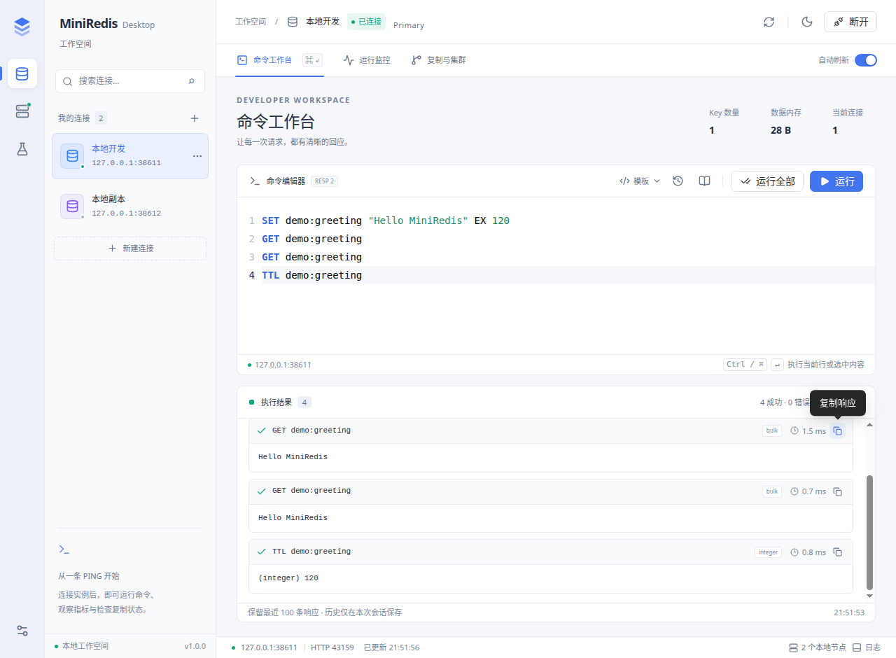

# MiniRedis

基于 C++20 的轻量 KV 缓存服务，使用协程、epoll 和分片存储实现 RESP 请求处理，提供持久化、监控、主从复制及实验性集群功能。

服务端面向 Linux 本地和内网环境。项目用于研究和验证服务端工程设计，功能与兼容性范围见下文。

## 快速开始

需要 Linux、CMake 3.20+ 和支持 C++20 的编译器。`redis-cli` 用于命令交互；完整测试还需要 `curl`、Bash 和 Python 3。

```bash
cmake -S . -B build -DCMAKE_BUILD_TYPE=Release
cmake --build build -j
ctest --test-dir build --output-on-failure

./build/miniredis --requirepass change-me
```

在另一个终端验证：

```bash
REDISCLI_AUTH=change-me redis-cli -p 6366 PING
REDISCLI_AUTH=change-me redis-cli -p 6366 SET greeting hello EX 60
REDISCLI_AUTH=change-me redis-cli -p 6366 GET greeting
curl -fsS http://127.0.0.1:8080/readyz
```

使用 Docker：

```bash
MINIREDIS_REQUIREPASS=change-me docker compose up --build
```

配置、命令和桌面端启动方法见 [使用指南](docs/usage.md)。安装、备份和故障处理见 [部署与运维](docs/ops-runbook.md)。

## 功能范围

| 模块 | 已实现 |
| :--- | :--- |
| 网络与协议 | 多 Reactor、C++20 协程、RESP 增量解析、pipeline、连接及缓冲区限制 |
| 存储 | String/KV 命令、分片锁、64B 小值内存池、毫秒 TTL、分片内存额度、noeviction/LRU |
| 持久化 | 二进制快照、备份回退、AOF、后台 rewrite、不完整尾部恢复 |
| 访问控制 | AUTH、用户角色、命令白名单/黑名单、key 前缀权限 |
| 可观测性 | `/healthz`、`/readyz`、JSON `/stats`、Prometheus `/metrics`、INFO、SLOWLOG |
| 复制与故障转移 | 异步复制、replid/offset 校验、backlog 追平、静态成员组多数派选主和写入隔离 |
| 实验性集群 | slot 路由、MOVED/ASK、slot 迁移、拓扑保存及手动接管 |
| 管理与部署 | Vue + Electron 桌面端、Docker、systemd、安装及备份脚本 |

桌面端使用 Vue 3、TypeScript 和 Electron，提供命令编辑器、独立连接会话、运行监控、复制与集群视图，以及本地实例和脚本任务入口。默认浅色，也支持深色主题。

先构建服务端，再使用 Node.js 24+ 启动桌面端：

```bash
cd tools/desktop
npm ci
npm run dev
```



## 项目结构

```text
src/                服务端实现：core、net、persistence、metrics、cluster、server
include/miniredis/  对应模块的头文件
config/             本地与部署配置示例
tests/              单元测试和黑盒集成测试
tools/desktop/      Vue 3 + TypeScript + Electron 桌面管理端
scripts/            压测、恢复验证和多节点演示
deploy/             安装、备份、systemd 和日志轮转
docs/               使用、设计、运维和验证文档
```

## 文档

| 任务 | 文档 |
| :--- | :--- |
| 构建、平台支持、配置与命令 | [使用指南](docs/usage.md) |
| 模块职责、请求链路与并发约束 | [架构设计](docs/architecture.md) |
| 安装、升级、备份恢复与排障 | [部署与运维](docs/ops-runbook.md) |
| 主从同步与自动故障转移 | [复制机制](docs/replication.md) |
| slot 路由、迁移与接管 | [Cluster 模式](docs/cluster.md) |
| 测试、sanitizer 与压测方法 | [测试与压测](docs/testing-benchmark.md) |
| 压测环境与历史样本 | [压测报告](docs/benchmark-report.md) |
| 桌面端操作与演示步骤 | [演示指南](docs/demo-guide.md) |

## 使用边界

- 支持 String/KV 命令子集，未实现 List、Hash、Set、ZSet 等数据结构；ACL 也只支持项目定义的语法。
- 原生服务端依赖 Linux 的 epoll/eventfd。桌面端通过 RESP/HTTP 连接服务端；当前 CI 验证 Linux，Windows/macOS 的构建与打包需另行验证。
- 未实现 TLS，部署时应限制到可信网络，并配置认证。
- 复制是异步的，主节点故障时可能丢失尚未到达副本的写入。自动选主面向静态小规模成员组，未实现成员动态变更或完整共识日志。
- 复制与集群协议不兼容完整 Redis PSYNC2、Sentinel 或 Cluster gossip；集群功能仍属实验性质。
- 压测报告是开发环境样本，评估部署容量时应使用目标环境重新测试。
