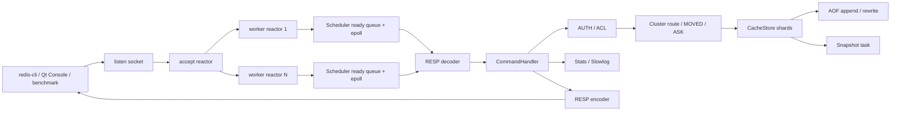
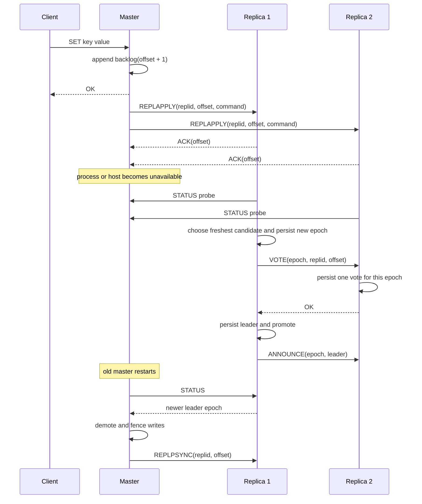

# 架构设计

## 项目结构

MiniRedis 将运行时代码、应用入口、测试和运维资源分开：

```text
include/miniredis/  # 对外头文件，目录与 src 中的实现对应
src/
├── app/            # 服务端程序入口
├── core/           # KV 存储、内存池、线程池
├── net/            # epoll 调度器、RESP 编解码
├── persistence/    # snapshot、AOF 与持久化编排
├── metrics/        # stats 统计和 HTTP 暴露
├── cluster/        # slot 路由、拓扑与节点状态
└── server/         # 配置、命令处理和服务生命周期
tests/              # 单元测试与黑盒集成测试
tools/qt_console/   # 可独立构建的跨平台管理端
config/             # 开发与生产配置样例
deploy/             # systemd、logrotate、安装和备份脚本
scripts/            # 压测、恢复、复制与集群验证脚本
docs/               # 架构、部署、运维与测试文档
```

`src/app/main.cpp` 只保留入口逻辑：解析配置并启动 `MiniRedisServer`。公共实现编译为 `miniredis_runtime` 静态库，由服务端入口和单元测试复用；命令处理集中在 `server/command_handler`，服务生命周期集中在 `server/server`。

| 模块 | 职责与边界 |
| :--- | :--- |
| `core` | 内存中的 KV、TTL、内存额度及基础资源管理 |
| `net` | epoll 调度和 RESP 编解码；`RespWriter::array` 统一编码复制与 AOF 命令 |
| `persistence` | 文件格式、恢复和后台落盘，不承担客户端命令授权 |
| `cluster` | slot 映射、拓扑存储和公共节点地址解析 |
| `server` | 认证授权、命令语义、复制和服务生命周期；通过具名 `CommandContext` 注入可选依赖 |
| `metrics` | 指标采集、快照和 HTTP 导出 |

扩展命令时需同步处理命令元信息、权限、路由、AOF 和复制语义，并补充相应行为测试。源码按职责分层；可选 Qt 管理端保持独立，不链接 Linux runtime。

## 核心流程



网络层采用多 Reactor 模型：accept reactor 只负责监听 socket 和接收新连接，连接 fd 会按 round-robin 分发给 worker reactor。每个 worker reactor 拥有独立 `Scheduler`、epoll fd、eventfd 和 ready queue，客户端读写在对应 worker 线程内以 coroutine 方式执行。

## 并发与生命周期

| 共享状态 | 并发策略 |
| :--- | :--- |
| 客户端连接 | 每个 fd 由一个 worker reactor 驱动；连接内的解码器和会话状态不跨线程共享 |
| CacheStore shard | 每个 shard 一把 `shared_mutex`；GET 需要更新 LRU、可能删除过期项，因此实际使用独占锁 |
| 固定块内存池 | mutex 保护空闲链表；CacheStore 在覆盖、删除及过期时归还块 |
| snapshot | 逐 shard 加共享锁复制存活数据，文件 IO 在锁外执行；后台任务用 `snapshot_running_` 防重入 |
| AOF | mutex 串行保护追加和 rewrite buffer；rewrite 分批在锁外写临时文件，最终切换短暂持锁 |
| 复制应用 | `replication_apply_mutex` 串行保护应用顺序与 offset 更新 |
| ClusterSlotMap | 内部 mutex 保护映射和 epoch；外层锁保护迁移、接管等跨对象操作 |
| Stats | 计数器使用 atomic，慢日志和节点地址使用 mutex；查询允许统计值略有滞后 |

CacheStore 的 snapshot 和统计逐个遍历 shard，不能视为所有 shard 在同一时刻的原子视图。内存池只管理块复用，业务对象生命周期仍由 shard 锁保护。

## 核心不变量

| 范围 | 必须保持的约束 | 实现方式 |
| :--- | :--- | :--- |
| 连接归属 | 一个客户端 fd 同一时刻只由一个 worker reactor 驱动 | accept reactor round-robin 分发，之后不跨 worker 迁移 |
| 协程生命周期 | 已完成的 coroutine handle 不能再留在 ready queue 或 fd map | Scheduler 销毁 task 前清理 ready handle 和 epoll 映射 |
| KV 并发 | 单 key 操作只锁定命中的 shard | key hash + shard 级 `std::shared_mutex` |
| 复制连续性 | 只有 replication ID 一致且 offset 连续时才能增量续传 | `replid + offset + backlog`，不匹配时回退全量同步 |
| 选主安全 | 每个节点在同一 epoch 最多投一票 | epoch/vote 先持久化再返回投票结果 |
| 写入权限 | replica 不接受普通写；自动模式的 master 丢失多数派后不接受写 | 分别返回 `READONLY` 和 `MASTERDOWN` |
| 持久化切换 | 正式 snapshot/AOF 不能暴露半截新文件 | 临时文件 + `fsync` + `rename` + 目录 `fsync` |
| slot 归属 | 一个 slot 在稳定状态只有一个 owner | 16384 项固定映射，takeover 按 epoch 原子更新 |

这些约束也是测试设计的主线：功能测试验证命令返回，故障测试验证服务在重启、断线、损坏文件和丢失多数派后仍不破坏不变量。

## 复制与自动故障转移



正常写路径不等待副本网络：master 在本地写入成功后追加 backlog 并通知后台 dispatcher，每个 replica 拥有独立长连接。这是异步复制，因此 master 在数据尚未到达副本时崩溃，最新少量写入仍可能丢失。

自动故障转移使用显式配置的静态小规模节点组。候选者先比较 replication offset，offset 相同时使用节点地址稳定决胜；获得多数票后才晋升。该机制用于降低单主故障恢复和脑裂风险，不等同于 Raft 日志复制、Redis Sentinel 或完整 Redis Cluster gossip。

## 故障语义

| 场景 | 对外行为 | 恢复路径 |
| :--- | :--- | :--- |
| 请求发送到 replica | 读允许，普通写返回 `READONLY` | 客户端连接当前 master |
| master 丢失 failover quorum | 写返回 `MASTERDOWN`，读仍可用 | 恢复多数派连通性 |
| key 归属其他 slot owner | 返回 `MOVED <slot> <node>` | 客户端重连目标节点 |
| slot 正在迁移 | 源节点可返回 `ASK` | 客户端向目标节点发 `ASKING` 后重试 |
| backlog 不包含 replica 所需 offset | 拒绝错误增量续传 | 回退到全量 snapshot 同步 |
| AOF 尾部不完整 | 保留前面完整命令，丢弃坏尾 | 修复文件尾部后继续追加 |
| 主 snapshot 损坏 | 拒绝加载损坏数据并保留 `.bad` | 尝试加载 `.bak` |
| `maxmemory + noeviction` 超限 | 新写入返回 OOM | 删除 key、增大上限或切换 LRU |

## 性能热路径

```text
GET: epoll -> coroutine -> RESP parse -> ACL/route -> shard unique lock -> encode -> socket
SET: epoll -> coroutine -> RESP parse -> ACL/route -> shard unique lock
     -> memory pool/heap -> optional AOF -> backlog publish -> encode -> socket
```

- 小 value 命中 64B 内存池，但 key、hash 节点和协议 buffer 仍会使用标准容器分配，不应宣称“零 malloc”。
- sharded CacheStore 降低锁竞争，但 snapshot、cleanup 和全局统计仍需遍历所有 shard。
- AOF `always` 将 `fsync` 成本放在写路径；`everysec` 与关闭 AOF 的延迟和丢数据窗口不同。
- 复制推送不阻塞客户端响应，代价是异步复制不保证零数据丢失。
- 性能结论以多轮 QPS 波动和 p95/p99 为主，不只展示单轮峰值。

## CacheStore

- 按 key hash 拆分为多个 shard，每个 shard 使用独立 `std::shared_mutex`
- 单 key 操作只锁命中的 shard，`snapshot()`、`cleanup()` 和统计类操作会遍历所有 shard
- value 小于等于 64B 时使用固定块内存池
- 大 value 自动走堆分配
- 支持 TTL、惰性删除和后台 cleanup
- `snapshot()` 只导出未过期 key，并保存 TTL key 的绝对过期时间
- 支持 `maxmemory` payload 估算内存上限
- 开启多 shard 时，`maxmemory` 按 shard 均分，余数字节分配给前面的 shard；额度为 0 的 shard 拒绝非空写入，全局 `maxmemory=0` 才表示不限额
- `used_memory` 统计 key/value 字节数，不包含容器节点、协议缓冲、线程栈等进程内存；不能直接等同于 RSS
- `noeviction` 策略在超限时拒绝写入
- `lru` 策略在命中 shard 内扫描并淘汰最近最少访问 key；这是局部 LRU，扫描成本随 shard 大小增加

## 持久化

快照文件使用二进制格式：

- magic header：`MINIREDIS_SNAPSHOT_V2`
- entry count
- 每条记录保存 `key_length`、`value_length`、`expire_at_ms`、key bytes、value bytes
- `expire_at_ms` 为 Unix 毫秒时间戳，0 表示永久 key
- 加载时限制最大 entry 数，避免损坏快照触发巨大内存申请
- 单条 key/value 长度做边界校验，异常文件会被拒绝加载
- 兼容读取 V1 二进制快照，V1 key 会按永久 key 恢复

保存流程：

1. 写入 `snapshot.tmp`
2. flush
3. `fsync(snapshot.tmp)`
4. 将旧 `snapshot.dat` 复制为 `snapshot.dat.bak`
5. `rename(snapshot.tmp, snapshot.dat)`
6. `fsync` 快照所在目录

这样可以避免进程崩溃时把正式快照覆盖成半截文件。启动加载时如果主快照损坏，会移动为 `.bad` 并尝试加载 `.bak` 备份。定时快照会提交到动态线程池异步执行；如果上一轮快照仍在执行，本轮会跳过，避免并发写同一个快照文件。新版本仍兼容读取 V1 二进制快照和旧版 `key value` 文本快照，但下一次保存会升级为 V2 二进制格式。

AOF 是可选增量日志，开启 `appendonly_file` 后，成功执行的 `SET`、`SETNX`、`APPEND`、`INCR/DECR`、`DEL`、`GETDEL`、`EXPIRE/PEXPIRE`、`PERSIST`、`GETEX` 会追加到 AOF 文件。`SETNX`、`APPEND`、整数自增类命令和取消 TTL 类命令会记录为等价的最终 `SET`，AOF 记录使用 RESP array 编码内部命令，因此可以安全保存包含空格、换行或二进制内容的 key/value。TTL 在 AOF 中保存为 Unix 毫秒绝对过期时间，避免重启 replay 时把 TTL 重新续满。

启动恢复顺序：

1. 加载 snapshot
2. 读取当前内存快照
3. replay AOF 到这份快照数据上
4. 将合并后的数据加载回 CacheStore
5. 打开 AOF 进入追加写模式

`appendfsync` 支持 `no`、`everysec`、`always`。`BGREWRITEAOF` 会在后台线程基于当前内存快照生成 compact AOF，将多次覆盖、删除和过期后的历史命令压缩为每个存活 key 一条 `SET`/`PXAT` 记录；rewrite 期间的新写入会继续追加到旧 AOF，并同时进入 rewrite buffer。后台任务会分批把增量 buffer 交换到局部变量，在锁外写入临时文件，只在最终 `fsync + rename + reopen` 切换正式 AOF 时短暂持锁。启动时会清理残留 `.rewrite.tmp`，rewrite 失败会保留旧 AOF、记录最后状态/错误并允许后续重试；rewrite buffer 设置上限，避免长时间 rewrite 时内存无限增长。

## 监控指标

stats HTTP server 是轻量同步实现，面向健康检查和低频监控。请求读取会循环到 HTTP header 完整，响应写回会循环直到全部发送完成，并对过大的请求头返回 431。

指标覆盖命令数、命中率、连接及拒绝数、延迟、内存额度与淘汰、资源限制、快照、AOF rewrite 和复制状态。接口使用方式见 [使用指南](usage.md)，部署监控和排障见 [部署与运维](ops-runbook.md)。

## 当前维护重点

`command_handler.cpp`、`server.cpp` 和 Qt 的 `monitor_window.cpp` 仍承担较多职责。继续演进时，应按实际功能变更提取命令分组、复制生命周期和界面组件；暂时保留现有模块边界，避免仅为降低行数增加转发层和零散文件。

并发与恢复验证统一见 [测试与压测](testing-benchmark.md)。复制选举约束见 [复制机制](replication.md)，slot 迁移约束见 [Cluster 模式](cluster.md)。
