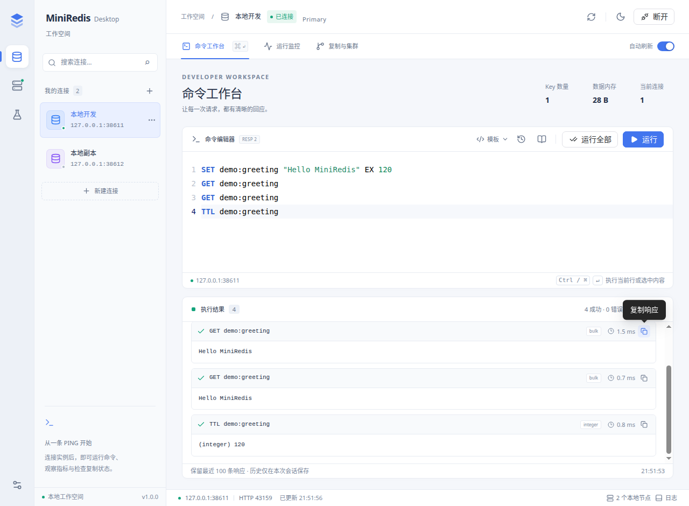
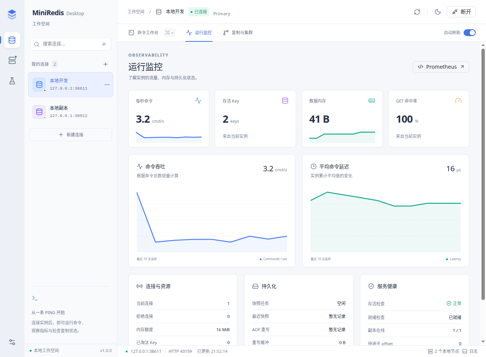
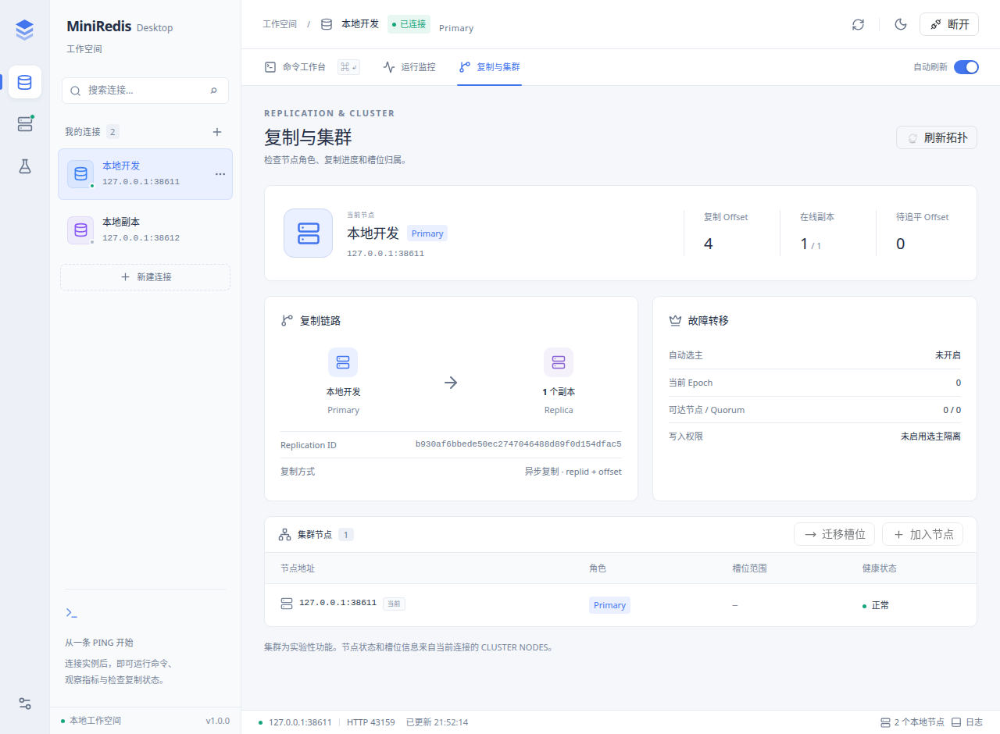

# 操作与演示指南

本文给出约 8 分钟的功能验证流程：启动服务、执行命令、检查监控、验证恢复与故障转移，最后查看压测证据。设计约束见 [架构设计](architecture.md)。

## 演示前检查

```bash
cmake -S . -B build -DCMAKE_BUILD_TYPE=Release
cmake --build build -j
ctest --test-dir build --output-on-failure

cd tools/desktop
npm ci
npm run dev
```

在侧栏“本地实例”中选择编译好的 `build/miniredis`。默认端口为 RESP `6366` 和监控 `8080`，多节点模式顺次递增；启动前确认端口空闲。也可以添加连接，直接使用已经运行的服务。

## 时间线

| 时间 | 界面/动作 | 要证明的能力 |
| :--- | :--- | :--- |
| 0:00-0:40 | 一句话定位 + 主界面 | 这是轻量内网 KV 中间件，不是完整 Redis 替代品 |
| 0:40-2:00 | 本地实例 + 命令工作台 | 配置化启动、RESP、TTL、String/KV 命令 |
| 2:00-3:00 | 运行监控 + Prometheus | 健康检查、命中率、延迟、持久化状态 |
| 3:00-4:10 | 持久化演示 | snapshot/AOF、rewrite、重启恢复 |
| 4:10-6:20 | 自动故障转移 | offset 选候选者、epoch 投票、旧主降级、quorum 写隔离 |
| 6:20-7:20 | 任务中心 + 报告 | 多轮 QPS、p95/p99、波动和 Redis 同机参考 |
| 7:20-8:00 | 架构图 + 边界 | 总结设计取舍，主动说明非完整 Redis |

## 1. 定位与启动

开场可以直接说：

> MiniRedis 是面向中小型后台和内网环境的轻量 KV 缓存中间件。我的重点不是复制 Redis 全部功能，而是完整贯通 C++ 异步网络、并发存储、持久化、可观测性和小规模 HA。

在侧栏“本地实例”中启动单节点，建议展示这些配置：

```text
bind: 127.0.0.1
RESP port: 6366
stats port: 8080
requirepass: demo-secret
AOF: enabled / everysec
maxmemory: 64 MiB
eviction: lru
IO threads: 4
cache shards: 16
```



## 2. 命令链路

连接后在命令编辑器中一次执行：

```text
PING
SET demo:user:1001 tom EX 120
GET demo:user:1001
INCR demo:counter
APPEND demo:user:1001 !
STRLEN demo:user:1001
MGET demo:user:1001 demo:counter missing
TTL demo:user:1001
INFO stats
```

讲解链路：

```text
socket -> worker reactor -> coroutine -> RESP decoder
       -> ACL / slot route -> sharded CacheStore
       -> AOF / replication / stats -> RESP encoder
```

不需要演示所有命令。上面一组已经能证明协议、TTL、多 key 返回和可观测命令。

## 3. 监控与诊断

打开顶部“运行监控”，展示：

- 命令数、GET 命中/未命中和命中率
- 连接数、拒绝连接数和命令 p95/p99 延迟
- key 数、payload 内存、内存池和淘汰数
- snapshot/AOF rewrite 状态
- replication/failover 的 replid、offset、epoch、quorum 和写权限

健康与就绪状态来自 `/healthz` 和 `/readyz`。点击 Prometheus 查看原始指标；在命令工作台执行 `INFO persistence` 和 `SLOWLOG GET 10` 查看诊断信息。



## 4. 持久化恢复

1. 执行 `SET demo:persist survived`。
2. 在命令工作台执行 `BGREWRITEAOF`，用 `INFO persistence` 确认 rewrite 完成。
3. 在“本地实例”停止全部节点，再使用相同端口、模式和 AOF 配置重新启动。
4. 再执行 `GET demo:persist`，应返回 `survived`。

说明 snapshot 通过 `tmp + fsync + rename + directory fsync` 原子替换，AOF rewrite 期间的新写入进入增量 buffer；恢复脚本另外覆盖 AOF 坏尾和损坏 snapshot 回退。

## 5. 自动故障转移

在侧栏“任务中心”选择“自动故障转移验证”并运行。脚本会在分配的临时端口启动 `1 master + 2 replicas`，底部日志显示选主、追平、旧主降级和写入隔离结果。以下是示例，实际端口与 epoch 以运行输出为准：

```text
election result: leader=127.0.0.1:6387, epoch=1, quorum=2/3
replication result: key=ha:after, master=127.0.0.1:6387, replica=127.0.0.1:6388, value=elected
recovery result: old-master=127.0.0.1:6386, role=slave, follows=127.0.0.1:6387, data=up-to-date
stale-master fence: ERR READONLY ...
quorum fence: reachable=1/3, writes_allowed=0, response=ERR MASTERDOWN ...
```

这一段建议讲四个词：`offset 选举`、`epoch 持久化`、`多数派`、`写隔离`。主动补充这是静态小规模节点组，不是 Raft 或完整 Sentinel。

本地实例也可以选择“主从复制”或“自动故障转移”模式，启动后在“复制与集群”查看节点信息。在本地实例面板停止某个受管节点后，观察真实状态变化。



## 6. 压测证据

现场只跑短压测，完整数据直接打开 [benchmark-report.md](benchmark-report.md)。生成三轮统计和 Redis 同机参考：

```bash
RUNS=3 BASELINE_REDIS=1 \
REQUESTS=100000 CLIENTS=50 \
VALUE_SIZES="64 1024 10240" \
scripts/benchmark.sh
```

展示时同时看：

- 平均 QPS 和最低 QPS
- QPS 变异系数（CV），说明轮次间波动
- p95/p99 和 worst max，说明尾延迟
- Redis 仅是关闭持久化后的同机参考，不表示两者功能等价

## 证据对照

| 项目主张 | 现场证据 | 自动化证据 |
| :--- | :--- | :--- |
| RESP 半包/粘包 | 桌面端多行命令与 redis-cli 可交互 | unit + integration smoke |
| TTL 和持久化 | 重启后 key/TTL 恢复 | recovery soak |
| AOF 可恢复 | rewrite 后重启可读 | 坏尾、rewrite 中断和 buffer 超限单测 |
| 复制连续性 | 新主写入传到副本 | replid/offset/backlog 测试 |
| 写入隔离 | `READONLY` 和 `MASTERDOWN` | failover smoke + ASan/UBSan |
| 性能 | 多轮聚合表 | TSV 逐轮数据 + 可重复脚本 |

## 备用方案

- 桌面端无法启动时，使用 `redis-cli` + `curl` 按同一顺序演示，不改变技术主线。
- 现场时间不足时，保留命令链路、failover 和压测报告，省略逐个功能页面。
- 现场环境抖动时，不解释单次 QPS，直接展示事先生成的三轮报告和 CV。
- 不在演示时现场编译、安装依赖 或修改集群配置，这些都应在演示前完成。
